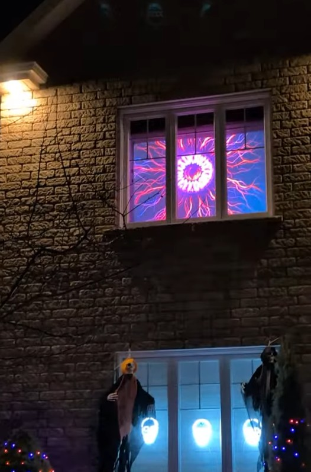
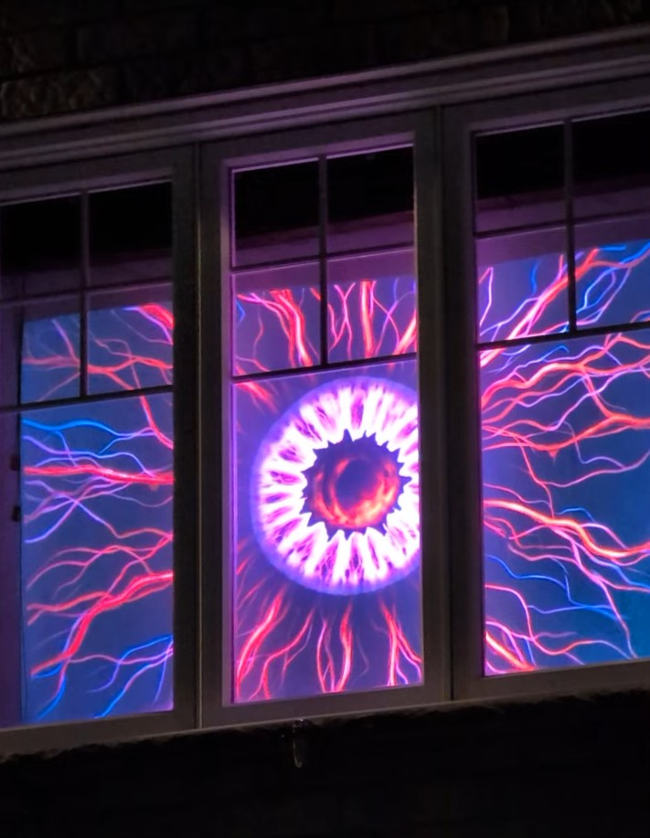

# Animated eye


A full-screen eye for a projector. The eye does not move: the window is a crop
of a larger image, and the crop is what slides, so the eye appears to glance
around with real saccades, drift, micro-saccades and a pupil that changes.

The photos below show it projected onto a house window for Halloween.

| The facade at night | Close-up: the iris and its fibres |
|---|---|
| [](https://youtube.com/shorts/nhEulSRSSkg) | [](https://youtube.com/shorts/nhEulSRSSkg) |

[Watch the animation](https://youtube.com/shorts/nhEulSRSSkg) (YouTube Shorts).

## Quick start

```bash
pip install -r requirements.txt
python main.py --list-displays    # which outputs are available
python main.py --display 1        # project on the second screen
```

`python main.py --window --debug` opens a small window with a HUD, to tune
without a projector. Everything lives in `config.json`, and every key has a
command-line option of the same name (`python main.py --help`).

Python 3.10 or newer, tested with 3.12 and pygame 2.6.1 (SDL 2.28). For the
tests: `pip install -r requirements-dev.txt`.

## How it works

The eye image is square and **bigger than the screen**, so the window only ever
shows a central crop of it. Each frame copies that crop to the projector,
offset by up to a few hundred pixels: the image never moves, the crop does. One
1920 x 1080 copy per frame, ~0.5 ms, wherever the eye is.

- `iris_fraction` sets the iris diameter as a fraction of the screen height, so
  it also sets the image scale: `0.51` on 1080p gives a 551 px iris and a
  2136 px image, just wider than the 1920 px screen.
- `travel_x` / `travel_y` set how far the crop may slide, in px: 660 and 250 by
  default, bounded so that the eye is never cut by the edge of the screen.

The reasoning behind that model, the exact bounds and the motion model are in
[docs/DESIGN.md](docs/DESIGN.md).

## Controls

| key | effect |
|---|---|
| `Esc` / `Q` | quit |
| `F` | toggle full screen / window |
| `B` | black screen (to focus the projector) |
| `D` | HUD: fps, phase, position, amplitude |
| `Space` | next eye image (cycles through `images`) |
| `1` `2` `3` | jump straight to an image |
| `S` | force a saccade |
| `P` | toggle the pupil animation |
| `R` | new random seed |

Picking an image by hand turns the automatic pupil animation off, otherwise the
next saccade could bring another image back and contradict the choice. `P` turns
it on again.

## Raspberry Pi

The eye can run without a PC: a Raspberry Pi wired to the projector is enough.

```powershell
.\scripts\deploy.ps1                    # copy, install, self-test
.\scripts\deploy.ps1 -InstallService    # start at boot, no PC needed
```

The target is never stored in the repository: set `ANIMATED_EYE_TARGET` once per
machine (a `user@host` string or an `~/.ssh/config` alias). Deployment options,
the systemd service and troubleshooting: [docs/DEPLOY.md](docs/DEPLOY.md).

## Configuration

Every setting lives in `config.json`, and its command-line equivalent wins over
the file. The full table with defaults and units: [docs/CONFIG.md](docs/CONFIG.md).

To use other eye images, drop them in `assets/` and add their names to `images`.
Images of a different size are accepted: the world is rebuilt when they appear.

## Verify without a projector

```bash
python tools/preview.py     # PNG sheets in preview/, drawn by the same code
python -m pytest tests -q   # test suite, headless
python main.py --selftest   # loads the real images, renders 120 frames
```

The tests check that the window really is a **crop of the image**, that the eye
never leaves the frame, that black only shows on the edge the eye leaves, and
that the window never runs out of the world.

## Project layout

```
main.py                   entry point: python main.py
animated_eye/             the package
  cli.py                  command line, selftest
  app.py                  loop: simulate -> world -> screen
  renderer.py             SDL window (full screen, DPI, sleep inhibitor)
  world.py                the big black surface and the sliding window
  eye_image.py            image loading, iris measurement, sprites
  saccade.py              motion: minimum-jerk, drift, micro-saccades
  pupil.py                pupil change: fade or hard cut
  geometry.py             crop, travel, memory budget (no pygame)
  config.py               config.json and command line
assets/                   eye images (2048 x 2048)
docs/                     README photos and the technical notes
scripts/                  Pi deployment, systemd unit, git hooks
tests/                    pytest, headless (SDL dummy driver)
tools/preview.py          control sheets rendered off screen
```

## Repository hygiene

The repository holds no host name, no account and no credential: the deploy
target lives in `ANIMATED_EYE_TARGET` on the machine, `.gitignore` keeps
environments and key material out, and a versioned hook refuses commits that
look like secrets. Enable it once per clone:

```bash
git config core.hooksPath scripts/hooks
```

Bypass deliberately with `git commit --no-verify`.

## Working on the code

Architecture, invariants, commands and known gaps, written so that a human or an
AI assistant can pick the project up cold: [AGENTS.md](AGENTS.md).

## License

MIT, see [LICENSE](LICENSE).


